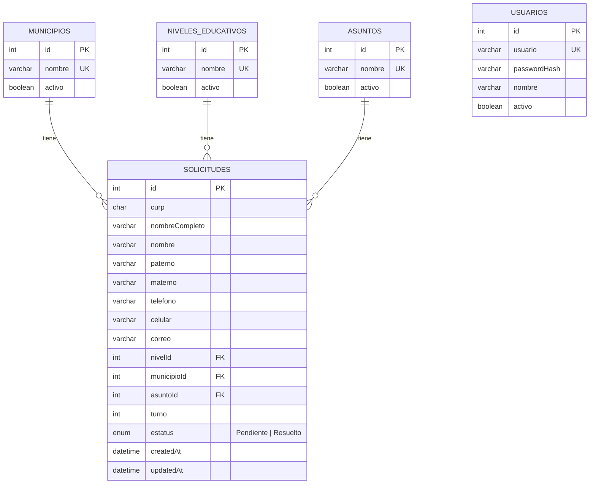

# Ticket de turno

Aplicación web para solicitar y administrar tickets de turno por municipio.
Proyecto del Parcial 2 — Desarrollo de Aplicaciones Web.

## Equipo
| Integrante | Rol |
|---|---|
| Angel (`miwaangel`) | Base de datos y backend |
| Orlando (`Tusked-D`) | Backend |
| Alanis (`Angel-Alanis`) | Frontend |

## Stack
- **Frontend:** React (Vite), con componentes de clase y servicios orientados a objetos
- **Backend:** Node.js + Express, arquitectura MVC orientada a objetos
- **Base de datos:** MySQL con Sequelize (ORM)
- **Patrones de diseño:** Singleton (`backend/src/config/Database.js`), Factory (`backend/src/services/documentos/DocumentoFactory.js`)

La interfaz React usa componentes de clase (`Component`) para encapsular estado,
ciclo de vida y comportamiento. La comunicación con la API está encapsulada en
servicios de clase como `SolicitudService`, `CatalogoService`, `AuthService` y
`EstadisticasService`; los adaptadores pequeños que conectan React Router con
componentes de clase únicamente inyectan navegación o ubicación.

## Estructura
```
backend/    API REST (Express)
frontend/   Cliente web (React)
docs/       Contrato de API y documentación
```

Antes de programar, leer **[docs/contrato-api.md](docs/contrato-api.md)**.

## Cómo correrlo

### Requisitos
- Node.js 20.19 o superior (`node -v`)
- MySQL encendido: XAMPP (Windows) o Docker / MySQL (Linux)

### 1. Backend (API) — terminal 1
```bash
cd backend
npm install
cp .env.example .env          # Windows: Copy-Item .env.example .env
```
Edita `backend/.env` con tu usuario de MySQL (`DB_USER`, `DB_PASSWORD`; en XAMPP: `root` y vacío). Luego:
```bash
npm run db:create             # crea la base ticket_turno
npm run db:migrate            # crea las tablas
npm run db:seed               # 38 municipios, niveles, asuntos, admin y 60 solicitudes de ejemplo
npm run dev                   # API en http://localhost:3000/api
```
Para volver a dejar la base como nueva: `npm run db:reset`.

### 2. Frontend — terminal 2
```bash
cd frontend
npm install
cp .env.example .env          # Windows: Copy-Item .env.example .env
npm run dev                   # http://localhost:5173
```
El `.env.example` ya viene listo para usar la API real (`VITE_USE_MOCKS=false`) y la llave de prueba de reCAPTCHA.
Para probar el front **sin** backend: `VITE_USE_MOCKS=true` (usuario `admin` / `admin123`).

### 3. Probar
| Qué | Dónde |
|---|---|
| Sitio público (solicitar, consultar, modificar) | http://localhost:5173 |
| Panel de administración | http://localhost:5173/login — usuario **`admin`**, contraseña **`Admin123!`** |
| Documentación de la API (Swagger) | http://localhost:3000/api/docs |
| Pruebas automáticas del backend (no necesitan MySQL) | `cd backend && npm test` |

### reCAPTCHA
Los `.env.example` traen las llaves **de prueba** de Google (siempre aprueban; el widget muestra un aviso de pruebas).
Para usar llaves reales: registrar el sitio en https://www.google.com/recaptcha/admin (v2 "No soy un robot", dominio `localhost`) y poner
la clave del sitio en `frontend/.env` → `VITE_RECAPTCHA_SITE_KEY` y la clave secreta en `backend/.env` → `RECAPTCHA_SECRET`.

### Validaciones
Los datos se validan en las dos capas. La CURP debe tener 18 caracteres y una
fecha, sexo, entidad federativa y consonantes internas consistentes; los
teléfonos aceptan únicamente 10 dígitos; nombres, correo, catálogos y turno
también tienen validaciones de formato, longitud y obligatoriedad.

## Flujo de trabajo
1. Cada quien trabaja en su rama (`miwa`, `orlando`, `alanis`).
2. Antes de empezar: `git pull origin develop`.
3. Al terminar un issue: Pull Request a `develop` con `Closes #N`.
4. Otro integrante revisa y hace merge.


## Base de datos

Comandos en `backend/` (ver **Cómo correrlo**): `db:create`, `db:migrate`, `db:seed`, `db:reset`, `db:test` (prueba la conexión) y `db:test-turnos` (prueba de turnos simultáneos).

### Patrón Singleton
`backend/src/config/Database.js` crea **una sola** conexión de Sequelize para toda la aplicación.
Se obtiene con `Database.getInstance()`; el constructor lanza un error si se intenta crear una segunda instancia.

## Modelo de datos



- Índice único `(municipioId, turno)`: cada municipio lleva su propio turno de 1 a n.
- `usuarios` no se relaciona con las demás tablas; solo sirve para el login de administradores.
- Detalle de tipos y reglas en [docs/contrato-api.md](docs/contrato-api.md).