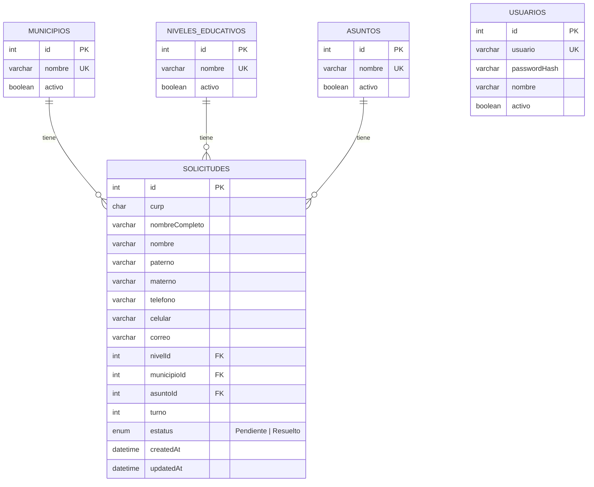

# Ticket de turno

Aplicación web para solicitar y administrar tickets de turno por municipio.
Proyecto del Parcial 2 — Desarrollo de Aplicaciones Web.

## Equipo
| Integrante | Rol |
|---|---|
| Angel (`miwaangel`) | Base de datos y backend |
| Orlando (`Tusked-D`) | Backend |
| Alanis (`Angel-Alanis`) | Frontend |

## Stack
- **Frontend:** React (Vite)
- **Backend:** Node.js + Express, arquitectura MVC orientada a objetos
- **Base de datos:** MySQL con Sequelize (ORM)
- **Patrones de diseño:** Singleton (conexión a BD), Factory (generación de comprobantes)

## Estructura
```
backend/    API REST (Express)
frontend/   Cliente web (React)
docs/       Contrato de API y documentación
```

Antes de programar, leer **[docs/contrato-api.md](docs/contrato-api.md)**.

## Cómo correrlo
_Se completa cuando estén listos el backend y el frontend._

```bash
# Backend
cd backend
npm install
cp .env.example .env   # y llenar los datos
npm run dev

# Frontend
cd frontend
npm install
npm run dev
```

## Flujo de trabajo
1. Cada quien trabaja en su rama (`miwa`, `orlando`, `alanis`).
2. Antes de empezar: `git pull origin develop`.
3. Al terminar un issue: Pull Request a `develop` con `Closes #N`.
4. Otro integrante revisa y hace merge.


## Base de datos

Requisitos: MySQL encendido (XAMPP).

```bash
cd backend
npm install
cp .env.example .env      # en Windows: Copy-Item .env.example .env
npm run db:create         # crea la base ticket_turno
npm run db:migrate        # crea las tablas
npm run db:seed           # datos iniciales (municipios, admin)
npm run db:test           # prueba la conexión
```

### Patrón Singleton
`backend/src/config/Database.js` crea **una sola** conexión de Sequelize para toda la aplicación.
Se obtiene con `Database.getInstance()`; el constructor lanza un error si se intenta crear una segunda instancia.

## Modelo de datos



- Índice único `(municipioId, turno)`: cada municipio lleva su propio turno de 1 a n.
- `usuarios` no se relaciona con las demás tablas; solo sirve para el login de administradores.
- Detalle de tipos y reglas en [docs/contrato-api.md](docs/contrato-api.md).